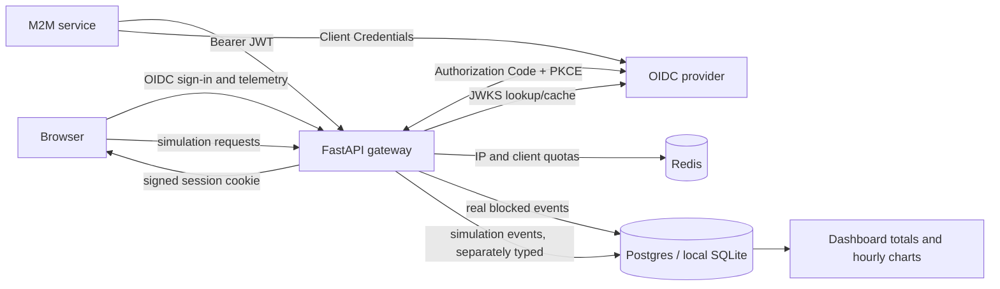
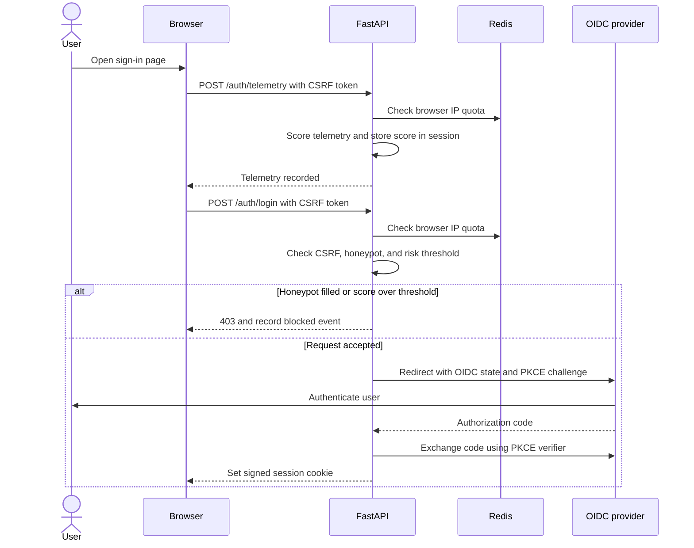
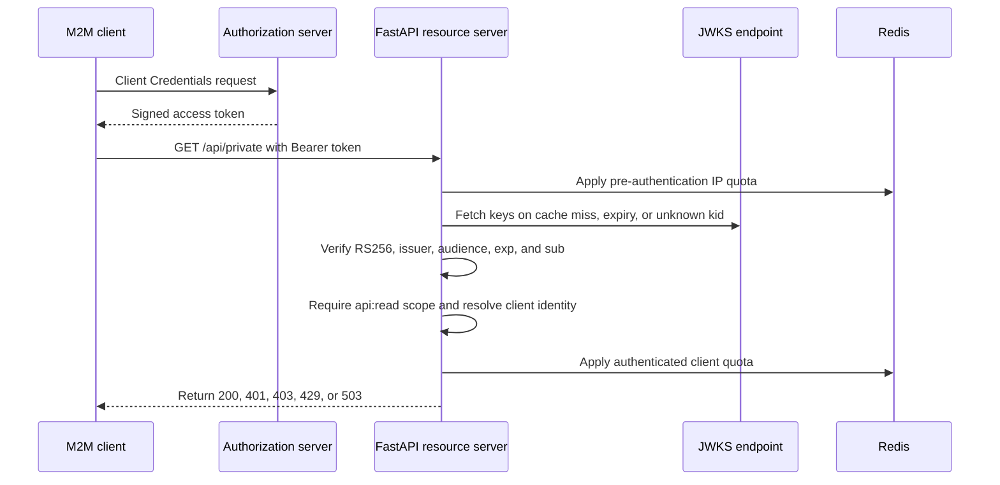
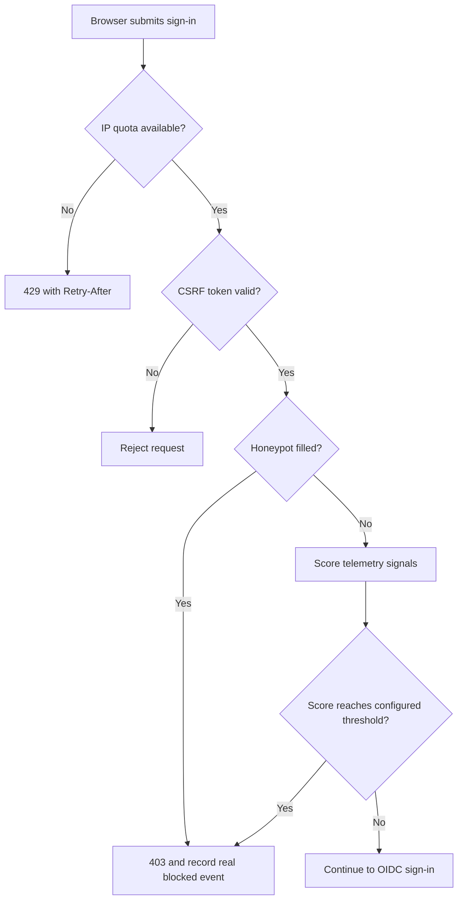
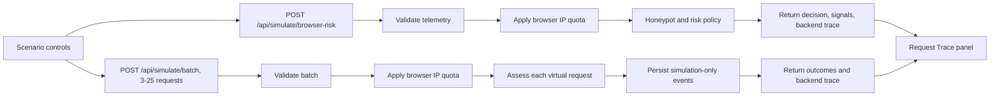

# AegisAuth

AegisAuth is an educational FastAPI gateway demonstrating identity-aware access for people and machine clients. It combines OIDC browser sign-in, scoped OAuth 2.0 access tokens, Redis rate limiting, explainable browser-risk rules, and an interactive simulation lab.

> **Status:** Educational reference implementation. It has production-oriented controls, but it is not publicly deployed and has not completed external IdP, managed Redis, Postgres recovery, or production traffic validation. Do not treat it as a certified gateway or bot-detection product.

## System Overview



The identity provider authenticates users and issues machine tokens. AegisAuth is the relying party/resource server; it does not store production passwords or issue OAuth tokens. Cloudflare Bot Management is not integrated. Browser-risk decisions are a small, explainable heuristic, not proof of human identity.

## Request Flows

### Human Sign-In



The local demo login is a development-only shortcut. With OIDC enabled, users enter credentials only at the provider.

### Machine-to-Machine Access



The JWKS cache is per application process. Unknown `kid` refreshes have a cooldown; Redis uses server time for distributed sliding-window quotas.

### Browser Risk Gate



The score weights WebDriver, very fast submission, no observed interaction, empty plugins, and unusual viewport dimensions. Missing interaction is weak evidence because password managers may not emit pointer or keyboard events. Only a combined score above threshold or a filled honeypot blocks sign-in.

### Simulation and Trace



Single evaluations are ephemeral. Batches persist events using separate event types; neither contributes to real blocked-attempt totals. The terminal panel shows client-observed events and trace steps returned by the backend, not raw server logs.

## Local Development

Requires Python 3.11 or newer. From the repository root:

```powershell
py -m pip install -e ".[dev]"
Copy-Item .env.example .env
```

Set `SESSION_SECRET` to a random local value and `DEMO_LOGIN_ENABLED=true` in `.env` to enable the visibly marked, one-click demo session. This is not authentication. Without an IdP, the simulator and dashboard still work; real sign-in and M2M validation remain unavailable.

```powershell
py -m uvicorn app.main:app --reload
```

Open [http://127.0.0.1:8000/](http://127.0.0.1:8000/). Sign In, Dashboard, and Risk Lab are sections on one page. `/health/live` checks process liveness; `/health/ready` checks the local database and, in production, Redis.

### Optional Local Keycloak

Docker Compose starts the seeded local realm:

```powershell
docker compose up -d keycloak
```

Set these local-only values in `.env`, then restart FastAPI:

```dotenv
OIDC_ISSUER_URL=http://localhost:8080/realms/aegisauth
OIDC_METADATA_URL=http://localhost:8080/realms/aegisauth/.well-known/openid-configuration
OIDC_CLIENT_ID=aegisauth-web
OIDC_CLIENT_SECRET=local-web-client-secret
OIDC_REDIRECT_URI=http://localhost:8000/auth/callback
JWKS_URL=http://localhost:8080/realms/aegisauth/protocol/openid-connect/certs
JWT_AUDIENCE=aegisauth-api
DEMO_LOGIN_ENABLED=false
```

The realm includes `demo` / `local-demo-password`, fictional test users, and the `aegisauth-machine` service-account client. All fixture credentials are public and local-only; never reuse them outside development. The machine API is `GET /api/private` and requires the `api:read` scope.

## Configuration

| Variable | Purpose |
| --- | --- |
| `APP_ENV` | `development` or `production`; production enables strict startup checks. |
| `DEMO_LOGIN_ENABLED` | Development-only local sign-in shortcut; defaults to `false`. |
| `SESSION_SECRET` | High-entropy signing key for browser session cookies. |
| `SESSION_HTTPS_ONLY` | Must be `true` in production. |
| `OIDC_ISSUER_URL` | Expected issuer for human and machine identity tokens. |
| `OIDC_METADATA_URL` | OIDC discovery document URL for browser sign-in. |
| `OIDC_CLIENT_ID`, `OIDC_CLIENT_SECRET` | OIDC relying-party credentials. Configure both with metadata URL. |
| `OIDC_REDIRECT_URI` | Callback URL registered with the provider. |
| `JWKS_URL` | Trusted issuer's signing-key endpoint. |
| `JWT_AUDIENCE` | Audience required by the M2M resource server. |
| `DATABASE_URL` | Async SQLAlchemy URL. SQLite is development-only; production requires Postgres. |
| `REDIS_URL` | Rate-limit store; production requires `rediss://`. |
| `RATE_LIMIT_REQUESTS`, `RATE_LIMIT_WINDOW_SECONDS` | Authenticated-client and browser quotas. |
| `M2M_IP_RATE_LIMIT_REQUESTS` | Pre-authentication M2M IP quota. |
| `BROWSER_RISK_THRESHOLD` | Score at or above which browser sign-in is rejected. |
| `SECURITY_EVENT_RETENTION_DAYS` | Retention for real and simulated events; defaults to 90 days. |

OIDC browser credentials may be omitted to host the public simulator. If configured, the OIDC client settings must be complete and HTTPS in production. M2M requires issuer, JWKS URL, and audience together.

## Production Operations

The Render blueprint runs `alembic upgrade head` before Uvicorn. Local development creates the SQLite schema automatically; production never calls `create_all`. Alembic migrations are versioned under `migrations/`.

Before exposing a deployment:

1. Provide Postgres, TLS Redis, a unique session secret, and HTTPS-only session cookies.
2. Register the exact OIDC callback URL. If enabling M2M, verify issuer, JWKS, audience, and `api:read` with the actual IdP.
3. Confirm the platform is the only trusted proxy path for forwarded IP headers; do not expose the origin directly when trusting forwarded headers.
4. Configure database backups and test restoration. The application purges events older than the configured retention period; choose that period to match your data policy.
5. Run CI, complete real IdP and Redis/Postgres integration checks, and inspect `/health/ready` before enabling traffic.

This repository is **not deployed to a public URL**. Keycloak, managed Redis, production Postgres, backup recovery, and real OIDC/M2M exchanges have not been verified in the hosted environment. Cloudflare Bot Management is a separate managed product and is not integrated; AegisAuth uses its own heuristic demo.

## Verification

```powershell
py -m pytest -q
py -m ruff check .
py -m ruff format --check .
```

CI also runs `alembic upgrade head` against a disposable SQLite database and executes the Playwright journey with Chromium. To run the browser journey locally, start the app with `DEMO_LOGIN_ENABLED=true`, install Chromium with `py -m playwright install chromium`, set `PLAYWRIGHT_BASE_URL`, then run `py -m pytest -q tests/e2e`.

## References

- [OpenID Connect Core 1.0](https://openid.net/specs/openid-connect-core-1_0.html), [OAuth 2.0 (RFC 6749)](https://www.rfc-editor.org/rfc/rfc6749), and [OAuth Security BCP (RFC 9700)](https://www.rfc-editor.org/rfc/rfc9700).
- [PKCE (RFC 7636)](https://www.rfc-editor.org/rfc/rfc7636), [JWT (RFC 7519)](https://www.rfc-editor.org/rfc/rfc7519), and [JWT BCP (RFC 8725)](https://www.rfc-editor.org/rfc/rfc8725).
- [Redis sorted sets](https://redis.io/docs/latest/develop/data-types/sorted-sets/), [SQLAlchemy asyncio](https://docs.sqlalchemy.org/en/20/orm/extensions/asyncio.html), and [Alembic](https://alembic.sqlalchemy.org/).
- [Keycloak realm import/export](https://www.keycloak.org/server/importExport), [Render FastAPI deployment](https://render.com/docs/deploy-fastapi), and [Playwright for Python](https://playwright.dev/python/docs/intro).
- [Cloudflare Bot Management](https://developers.cloudflare.com/bots/get-started/bot-management/) describes a managed Enterprise product; AegisAuth does not use its scores or APIs.